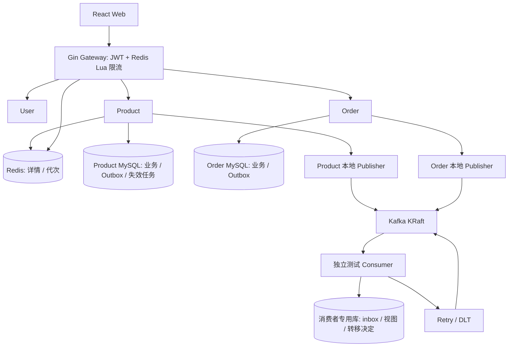

# Day 3 当前架构

图表示已实现的模块与可启用路径，不表示所有进程已在当前机器常驻运行。User、Product、Order 各自拥有数据库；通用包仅提供技术机制，不共享 GORM 业务模型，不建立跨库外键。独立测试消费者不直接读取业务库。

详情 Cache Aside 命中不访问商品库，Service 逐请求校验缓存快照的可见性；未命中由单进程 Singleflight 和有界回源保护。变更与失效任务同事务提交，Redis 代次 Lua 阻止失效后旧值回填。详情最终一致，MySQL 始终承担交易条件判断；Redis 重启后的旧缓存由持久化任务及绝对 TTL 兜底。

Gateway 总桶按可信用户或匿名 IP，叠加方法+路由模板桶；登录注册始终按 IP。Redis 正常时多实例共享额度，故障时读取使用有界本地桶，写接口保守返回503。额度不足才返回429，健康检查豁免。

业务与 Outbox 同本地事务，发布器短事务认领后在事务外等待 Kafka ACK，仅确认成功后写 PUBLISHED。ACK 与数据库状态更新不原子，允许重投。并发发布与 Retry 不保证聚合版本顺序；测试消费者同事务保存 event_id 去重与最高版本视图。

业务失败的 Retry/DLT 转移决定先持久化，转移 ACK 后才允许原 Offset 提交；重复消息复用决定，不增加业务尝试。测试消费者不代表 Feed/Search 完成。Kafka 单节点仅供开发，不提供多副本容灾；本轮未涉及 TLS、生产 ACL 或主从切换。

准确代码范围、实测结果与复验步骤见 [Day 3 验收](../testing/day3-acceptance.md)。历史系统开发文档中的早期 RabbitMQ/未实现记录仅代表当时状态，不作为现状依据。
